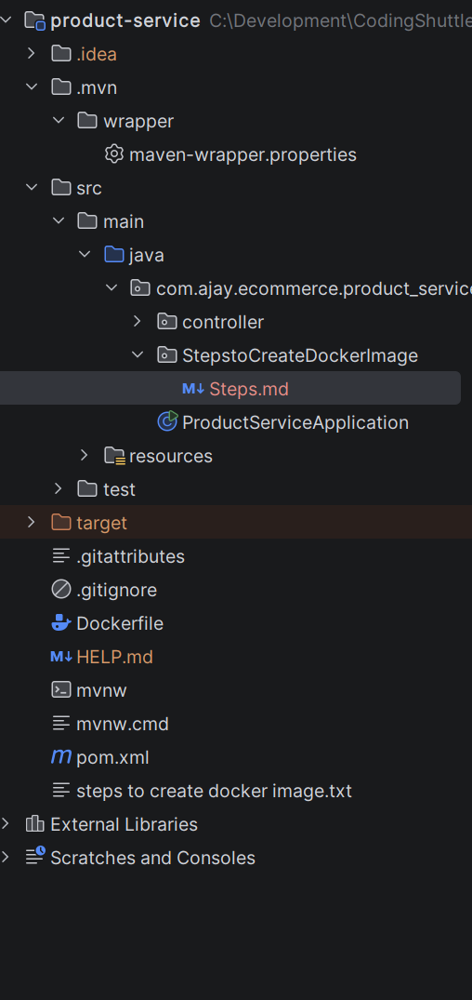
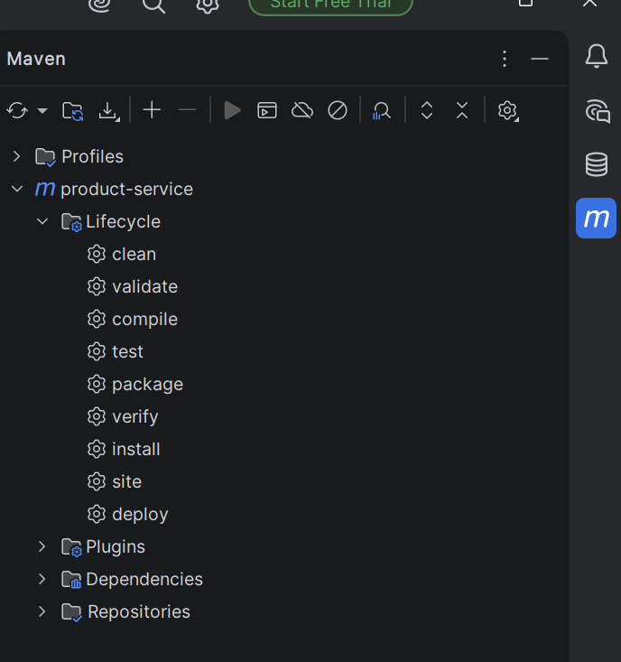
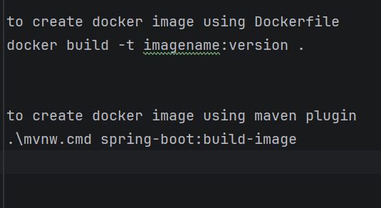

Steps:

--> Create Dockerfle in root :

--> refer DockerFile from our project 

--> open maven and double click on package:

 so the jar file will be created

--> use any one of the step to create Image : 

--> run this command to run the created image :  docker run -p 8080:8080 --name=myspringapp imagename:version
 
--> open browser and hit the endpoints